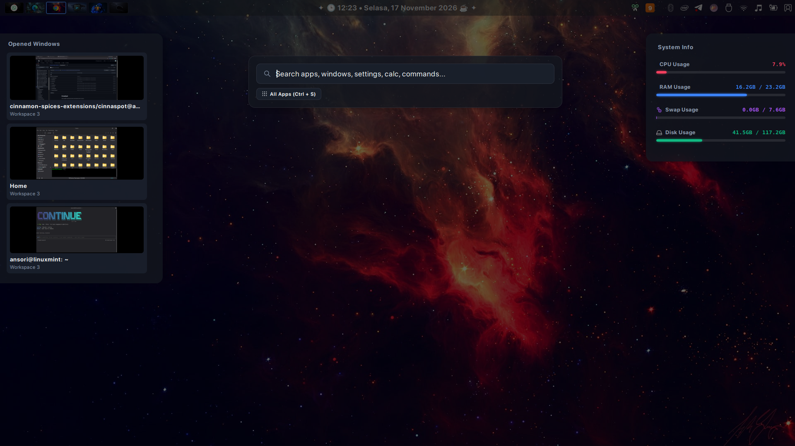

# CinnaSpot

A fast, feature-rich, Spotlight-inspired app launcher and productivity tool for Cinnamon.

---

## Preview



---

## Features

- **Instant Application Search**: Lightning-fast searching across all installed applications with relevance scoring.
- **All Applications Browser (`Ctrl + S`)**: Dedicated full-screen or modal browser for all installed applications with Grid and List view modes, sorting by Name or Category, and real-time filtering.
- **Opened Windows Sidebar**: View and switch between opened windows across workspaces with live clone thumbnail preview support.
- **System Info Sidebar**: Real-time monitoring for CPU usage, RAM, Swap, and Disk space with progress bars.
- **Built-in Calculator**: Perform quick mathematical calculations directly in the search bar (supporting operators, parentheses, and decimals) with instant clipboard copy.
- **System & Session Actions**: Quick triggers for power actions (Shutdown, Restart, Suspend) and session actions (Logout, Lock Screen, Switch User) with confirmation prompts.
- **Script Runner**: Run custom shell (`.sh`) and Python (`.py`) scripts directly using a configurable trigger prefix (e.g., `sh myscript`).
- **Multi-Display Support**: Automatically opens on the monitor where your mouse cursor is currently located.
- **Clean Tabbed Settings**: Organized settings layout utilizing tabs (General, Windows, System Info, Appearance, Actions, Scripts) for a clean and clutter-free configuration experience.

---

## Keyboard Shortcuts & Navigation

- **`<Super>space`**: Toggle CinnaSpot open/close (configurable in settings).
- **`Ctrl + S`**: Open the All Applications view.
- **`Esc`**: Close CinnaSpot or exit the All Applications view.
- **`Tab`**: Switch focus between search results and the opened windows sidebar.
- **`Up / Down`**: Navigate through items.
- **`Enter`**: Select/activate the focused item or action.

---

## Installation

1. Copy the extension directory to your local Cinnamon extensions folder:
   ```bash
   cp -r cinnaspot@ansori ~/.local/share/cinnamon/extensions/
   ```
2. Enable the extension from Cinnamon's **Extension Settings** or via command line:
   ```bash
   cinnamon-settings extensions
   ```

---

## Configuration

CinnaSpot's settings are cleanly grouped into tabs via Cinnamon's configuration layout:
- **General**: Hotkey, placeholder text, and maximum search results.
- **Windows**: Opened windows sidebar options, font size, and limits.
- **System Info**: Right sidebar metrics and disk partition path.
- **Appearance**: Theme (Dark/Light), background opacity, and result font size.
- **Actions**: Power and session action toggles.
- **Scripts**: Script runner prefix, search paths, and terminal execution command.
