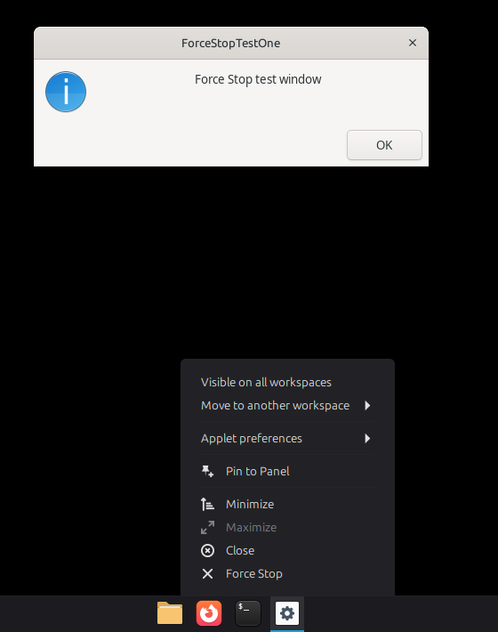
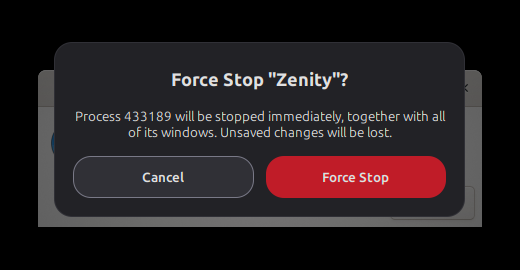
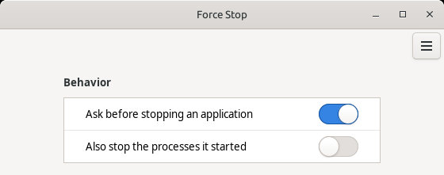

# Force Stop for Cinnamon

Adds a **Force Stop** item to the right-click menu of the Grouped window list, for applications that no longer respond to Close.

## What it does

- **Force Stop sits right below Close.** When an application has several windows, it sits below *Close all* instead.
- **It asks first.** The confirmation names the application and the process that is about to be stopped. `Escape` cancels it.
- **Optionally, it stops the processes the application started too.** This is off by default.
- **It knows when it cannot help.** The item is greyed out for windows without a process ID, and for processes of another user such as an application running as root.

Stopping means `SIGKILL`. The application gets no chance to save anything.

## Settings

System Settings → Extensions → **Force Stop** → *Configure*.

| Setting | Default | What it does |
| --- | --- | --- |
| Ask before stopping an application | On | Shows the confirmation dialog. Turn it off to stop an application the moment you click Force Stop. |
| Also stop the processes it started | Off | Stops the helper processes of the application as well. This includes anything launched from its built-in terminal, such as a local web server or a database. |

Changes take effect at once. *More options → Reset to defaults* restores both.

## Requirements

- Cinnamon 6.6 with its standard *Grouped window list* applet. Tested on Cinnamon 6.6.9 (Linux Mint 22.3) in an X11 session. Other Cinnamon versions and Wayland are untested.
- The `kill` command, which every distribution ships, for the child processes setting.

## How it works

The extension notices every popup menu that Cinnamon creates and, whenever the window list fills its right-click menu, appends the Force Stop item.

Stopping is done by Muffin, the window manager: `Meta.Window.kill()` sends `SIGKILL` to the process that owns the window. For the child processes, the process tree is read from `/proc` before the application is stopped, and everything found is stopped together with it.

The window list is changed in memory only. No file of Cinnamon is touched. The extension does depend on the internals of the Grouped window list: when a Cinnamon update changes them, the item is missing until the extension is updated, and nothing else is affected.

## Translations

User-visible strings are translatable. `force-stop@enisn/po/force-stop@enisn.pot` is the template.

## Source

The source repository, with the tests, is https://github.com/enisn/cinnamon-force-stop.

## License

MIT
