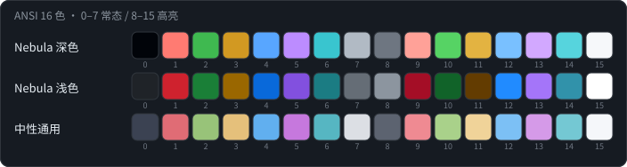

[中文](README.md) | **English**


# Nebula Theme Studio

A Linux Mint / Cinnamon extension. It treats **Nebula-Dark** and **Nebula-Light** as
templates and bakes a set of parameters into freely switchable custom themes.

> 🧩 **In short**: themes as templates, parameters baked into CSS, emitted as
> **independently named** complete theme directories — so they can be picked and
> switched in System Settings → Themes just like any regular theme.
> The source themes are never modified, and the generated output can be deleted at any time.

| Item | |
|---|---|
| 📥 Source themes | Nebula-Dark / Nebula-Light (bundled, installed on enable) |
| 📤 Output | `~/.themes/Nebula-<Variant>-Studio`, `~/.themes/Nebula-<Variant>-<Preset>` |
| 🎚️ Tunable parameters | 22 + 4 terminal palettes |
| 🔄 Cinnamon restart needed | **No** |

---

## 📑 Contents

- [✨ What it does](#what-it-does)
- [📦 Install](#install)
- [🔄 Workflow](#workflow)
  - [🎛️ What each button does](#buttons)
  - [⚖️ Suggested division of labor](#division)
- [🎚️ Parameters](#params)
  - [🖥️ Basics](#params-basic)
  - [🌫️ Opacity](#params-opacity)
  - [🎨 Colors](#params-color)
  - [📐 Shape & font size](#params-shape)
- [⌨️ Terminal palette](#terminal)
  - [🎛️ Terminal input area opacity](#terminal-opacity)
- [⚙️ Which system settings it touches](#system-settings)
  - [👆 One click in System Settings = full switch](#one-click)
- [📂 Where the data lives](#data)
  - [🏷️ Preset name → theme directory name](#naming)
- [⚠️ Known limitations](#limitations)

---

<a id="what-it-does"></a>
## ✨ What it does

| Stage | What happens |
|:--:|---|
| 📥 **Install** | On enable, installs the bundled Nebula-Dark / Nebula-Light into `~/.themes` (skips if already present, never overwrites your own changes) |
| 🎚️ **Tune** | 22 parameters — opacity, background colors, accent, corner radius, font size — rewritten as literals into the generated CSS |
| 🚀 **Apply** | Writes four gsettings keys; panels/menus reload instantly; open GTK apps are force-refreshed |
| 💾 **Archive** | Generates a standalone theme directory per preset name; many coexist and are picked like regular themes |
| ⌨️ **Terminal** | Optionally writes the ANSI 16-color palette of gnome-terminal |

---

<a id="install"></a>
## 📦 Install

```bash
ln -s "$PWD" ~/.local/share/cinnamon/extensions/nebula-theme-studio@yoo
```

Or simply copy the directory there. Then:

**System Settings → Extensions → Nebula Theme Studio** — turn it on.

Settings entry: **System Settings → Extensions → the gear icon next to this extension**
(or right-click → Preferences).

Requires Cinnamon 6.0 / 6.2 / 6.4 / 6.6. The terminal palette needs gnome-terminal;
if it is not installed, that part is skipped silently.

---

<a id="workflow"></a>
## 🔄 Workflow

```
Tune parameters in the extension
  ├─ Build and apply  →  writes the "working theme" ~/.themes/Nebula-<Variant>-Studio
  │                      a scratchpad for experiments, overwritten by the next build
  └─ Save as preset   →  writes the "archived theme" ~/.themes/Nebula-<Variant>-<Preset>
                         frozen products that never overwrite each other

System Settings → Themes → the "Nebula" section → pick one → everything switches at once
```

Example:

```
Preset "深海" + Nebula-Dark  →  ~/.themes/Nebula-Dark-深海
Preset "紫韵" + Nebula-Dark  →  ~/.themes/Nebula-Dark-紫韵
```

Both appear in the "Nebula / Dark" group of System Settings, side by side with the
original `Nebula-Dark`.

<a id="buttons"></a>
### 🎛️ What each button does

| Button | Behavior |
|---|---|
| **Build and apply** | Generates the working theme and switches to it. Does not save a preset |
| **Save as preset** | Generates an archived theme + writes the preset JSON. **Does not switch themes** |
| **Load preset and apply** | Pulls the preset's parameters back into the settings panel, regenerates the **working theme** and switches to it |
| **Delete preset and its theme directory** | Deletes the JSON + the theme directory (no orphan themes left behind). If the theme is in use, switches back to the source theme first |
| **Reset this theme to defaults** | Restores the current variant's parameters to defaults, deletes the working theme, switches back to the source theme |
| **Restore the original theme and delete generated output** | Deletes both working themes and switches back to the source theme of the current variant. Archived themes are kept |
| **Uninstall the two themes installed by the extension** | Removes only what this extension installed (tracked in `state.json`); anything you installed yourself is untouched |
| **Open preset folder** | Opens `~/.config/nebula-theme-studio/presets/` |
| **Open the README document** | Opens `README.md` inside the extension directory with the default app (at the bottom of the About page) |

<a id="division"></a>
### ⚖️ Suggested division of labor

| Action | Where |
|---|:---:|
| 🎛️ Tune parameters, freeze presets | Extension settings panel |
| 🔄 Switch between working and archived themes | System Settings → Themes |
| 🎨 Change icons / cursor | System Settings (the extension never touches these two) |

**Do not change the GTK theme through the "Themes" panel in System Settings**: it writes
the theme name into `~/.config/gtk-3.0/settings.ini` and `~/.gtkrc-2.0`, overriding what
the extension applied. To pick a generated theme, click it in the **theme selector**
of System Settings.

---

<a id="params"></a>
## 🎚️ Parameters

<a id="params-basic"></a>
### 🖥️ Basics

| Parameter | Range | Default | Notes |
|---|---|---|---|
| Theme variant | Nebula-Dark / Nebula-Light | Nebula-Dark | Which source theme to build from |
| Terminal palette (ANSI 16 colors) | Follow the system / Nebula dark / Nebula light / Neutral | Follow the system | See [Terminal palette](#terminal) below |
| Terminal input area opacity | 20% ~ 100% | **100%** (= force opaque) | See [Terminal input area opacity](#terminal-opacity) below |
| Main background color | Color palette | per variant | Base color of windows, entries and menu content; only background semantics are replaced |
| Panel background color | Color palette | per variant | Cinnamon panels, GTK header bars / toolbars / menubars |
| Menu background color | Color palette | per variant | Start menu, context popups, tooltips and other floating layers |
| Rebuild and apply automatically when parameters change | Toggle | Off | When on, rebuilds about 0.35 s after you stop changing a value |

<a id="params-opacity"></a>
### 🌫️ Opacity

Located by a `(selector, property, palette)` triple — only the matched layer is touched.

| Parameter | Range | Default | Applies to |
|---|---|---|---|
| Panel opacity | 30–100% | 70% | Top/bottom/left/right panels, GTK header bars, toolbars, menubars |
| Menu / popup opacity | 20–100% | 80% | Start menu, context menus, notifications, calendar, OSD, tooltips, GTK `menu` / `popover`, taskbar hover previews |
| Window background opacity | 30–100% | 90% | GTK window main background, dialog bodies |
| Hover / active state opacity | 20–100% | 60% | Highlight fills of hover / active / checked states |
| Soft accent fill opacity | 5–60% | Dark 15% / Light 20% | "Soft accent fills" such as selected menu rows. Does not affect accent borders or focus rings |

<a id="params-color"></a>
### 🎨 Colors

The color page has seven semantic palette roles: Accent color, Border color, Primary text
color, Secondary text color, Danger color, Warning color, Success color; the basics page
adds three background colors — Main / Panel / Menu (see the table above).

When switching between dark and light, colors **still at their defaults** migrate to the
new variant's defaults automatically; colors you customized are left alone.

<a id="params-shape"></a>
### 📐 Shape & font size

| Parameter | Range | Default |
|---|---|---|
| Window / menu corner radius (px) | 0–24px | 12px |
| Control corner radius (px) | 0–16px | 6px |
| Cinnamon base font size (pt) | 8–14pt | 10pt |

Corner radii are **scaled proportionally per tier**: the 12px tier and the 8px tier move
together, so at default values the output is byte-identical to the source theme. The
title bar's "rounded top, square bottom" shape is explicitly excluded and never broken.

---

<a id="terminal"></a>
## ⌨️ Terminal palette



Terminals do not follow the GTK theme — no rule in `cinnamon.css` / `gtk.css` can affect
gnome-terminal's colors. So this option has to land on its own profile
(the `palette` key of `org.gnome.Terminal.Legacy.Profile`, written to every profile).

| Icon | Scheme | Traits |
|:--:|---|---|
| 🚫 | **Follow the system** | No intervention at all. **Default** |
| 🌌 | **Nebula dark** | Slot 4 is the theme accent `#58a6ff`; slot 0 is darker than the background |
| ☀️ | **Nebula light** | Slot 0 uses the primary text color `#1f2328`, slot 15 the background `#ffffff` |
| 🎚️ | **Neutral** | Medium saturation and brightness; easy on the eyes over both dark and light backgrounds |

Two guarantees:

- **Only the ANSI 16 colors are changed** — `background-color` / `foreground-color` are
  never touched. The terminal's foreground and background keep following the GTK theme,
  so translucent-terminal setups are unaffected.
- **Switching back to "Follow the system" really restores.** Before the first override
  the original values are recorded into `state.json`; repeated applies never overwrite
  the backup; restoring clears it.

> Already-open terminal windows do not change color. VTE reads the profile once when a
> window is created — open a new window.

<a id="terminal-opacity"></a>
### 🎛️ Terminal input area opacity

gnome-terminal has its own background transparency, which does not follow the GTK theme
and can only land on its profile. It needs two keys together:

| Key | Meaning |
|---|---|
| `use-transparent-background` | Master switch; gschema default `false` |
| `background-transparency-percent` | **0 = fully opaque, 100 = fully transparent** (per the gschema text) |

This extension phrases the parameter as "opacity" (consistent with the other
`*-opacity` parameters, 100 = most solid) and inverts it when writing:
`transparency = 100 - opacity`.

**Pushing the slider to 100% really writes fully opaque** (`transparency-percent = 0`)
instead of "restoring whatever was there". A slider marked 100% that does nothing is the
surest way to make users think the feature is broken.

The price is that this parameter has no "hands-off" position: the 100% default will
override your existing terminal settings. To make that safe, **before taking over for
the first time, the original values of `use-transparent-background` and
`background-transparency-percent` are recorded per profile into the state file**, and
**"Restore the original theme"** on the maintenance page puts them back. You can always
return to your own setup — the entry point just moved from the slider to the
maintenance page.

The extension only touches the **input area background** — never the foreground color,
font, or cursor. Already-open terminal windows do not change; open a new one.

---

<a id="system-settings"></a>
## ⚙️ Which system settings it touches

| Key | Controls |
|---|---|
| `org.cinnamon.theme name` | Cinnamon panel / menu / overview |
| `org.cinnamon.desktop.interface gtk-theme` | **GTK3 apps** |
| `org.gnome.desktop.interface gtk-theme` | GTK4 / libadwaita apps, non-Cinnamon desktops |
| `org.gnome.desktop.wm.preferences theme` | Window title bars (metacity) |

All four must be written — none is optional: GTK3 apps only obey the theme name that
Cinnamon hands out via XSettings; GTK4 / libadwaita go through GSettings; and neither
chooser in System Settings touches the metacity one.

After applying: panels and menus reload instantly via Cinnamon; when a theme of the same
name is rebuilt, GTK3 apps are force-refreshed through a relay switch via the source
theme (individual apps may still cache — just reopen them).

<a id="one-click"></a>
### 👆 One click in System Settings = full switch

The Themes page of System Settings implements GTK theme, Cinnamon theme, icons and
cursor as **four independent** choosers, each writing only its own key — so one click
there often changes only half of the picture.

The extension watches theme switches. Once it finds the target is **generated by this
extension** (decided by the `.nebula-studio.json` marker file in the theme directory),
it fills in the remaining theme keys in one go — one click becomes a full switch.

Switching to a third-party theme, on the other hand, **leaves your combination completely
untouched** — deliberately using different themes for the shell and for GTK is a
legitimate need, and the extension does not overstep.

⚠️ **Parameters only apply to the currently selected variant**: the other variant's
generated directories stay at their old values until you switch to it.

---

<a id="data"></a>
## 📂 Where the data lives

| Path | Contents |
|---|---|
| `~/.themes/Nebula-<Variant>-Studio/` | Working theme (scratchpad) |
| `~/.themes/Nebula-<Variant>-<Preset>/` | Archived themes (finished products) |
| `~/.themes/<Theme>/.nebula-studio.json` | The theme's source variant, preset name, parameter snapshot |
| `~/.config/nebula-theme-studio/state.json` | Which source themes were installed; backups of the terminal palette and input opacity originals |
| `~/.config/nebula-theme-studio/presets/<Preset>.json` | Presets |

<a id="naming"></a>
### 🏷️ Preset name → theme directory name

```
Nebula-<Variant>-<Preset>
```

Sanitizing rules: whitespace (including full-width) → `-`; `\ / : * ? " < > |` and
control characters → `-`; consecutive hyphens are collapsed; leading/trailing symbols
trimmed. **Chinese names are kept as-is** — GTK, Cinnamon's themeManager and metacity all
load directories with Chinese names correctly.

Name clashes are rejected: empty after sanitizing, or the result is exactly the source
theme name / the working theme name.

---

<a id="limitations"></a>
## ⚠️ Known limitations

- **Already-open GTK3 apps do not refresh on their own when the theme name is unchanged** —
  reopen the app. The extension already force-refreshes most cases via a relay switch,
  but individual apps may still cache.
- **Already-open terminal windows do not change color** — open a new window.
- **GTK4 / libadwaita apps do not follow the relay switch.** They go through GSettings and
  are insensitive to same-value writes: they follow when the theme name changes, but need
  a restart after a same-name rebuild.
- **Newer GTK4/libadwaita apps (e.g. GNOME Files) don't read `~/.themes` at all** — no
  traditional theme works on them. That is an upstream design decision, not a bug of this
  extension.
- **The title bars of Qt apps and forced server-side-decorated (SSD) windows are drawn by
  the metacity theme**, with colors fixed at the source theme values; no parameter
  reaches them.
- **The Cinnamon base font size stacks on top of the system "text scaling"**: on HiDPI
  machines where scaling was already adjusted, the theme font size scales up
  proportionally — lower the base size one step if needed.
- **Do not change the GTK theme through the "Themes" panel of System Settings** — it
  writes `settings.ini` / `gtkrc-2.0` and conflicts with the extension's results.
- Each archived theme takes 160–185K (roughly double in disk blocks). A dozen presets are
  still only a couple of MB — acceptable; clean up if you keep many more.
- The terminal palette covers only the ANSI 16 colors, not 256-color or truecolor.
- Terminal input area opacity only works for **gnome-terminal**. xterm / konsole / tilix
  each have their own configuration locations, which the extension does not touch; when
  gnome-terminal is not installed, this option silently does nothing.
