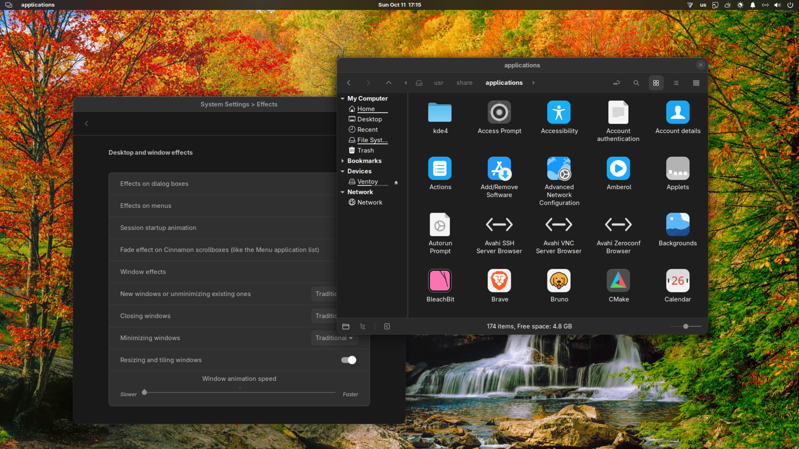

# Window Corners and Shadows

Rounds the corners of every window, and can draw a border and a drop shadow behind them.

It works by putting a small GLSL shader on each window's actor rather than by changing the window
manager theme. That is what lets it round windows which draw their own decorations - GTK apps with
header bars, browsers, anything using client-side decoration - which a window theme cannot reach,
because the toolkit has already drawn those corners by the time the window manager sees them.

Windows that should not have corners keep square ones: fullscreen windows always, and maximized
windows unless you ask for them to be rounded too.

## Options

- **Corner radius** - how round the corners are, in pixels. 0 turns rounding off.
- **Border width** - width of the hairline drawn around the window. Its colour is taken from the
  window itself, lightened on a dark window and deepened on a light one, so it stays in keeping
  with whatever app it is drawn on rather than being a fixed white or black line. 0 clips the
  corners without drawing an edge at all, which is what macOS does.
- **Draw window shadows** - draws the shadow behind each window from three layers: a tight contact
  shadow, a middle one, and a wide soft one, so it follows the rounded corners instead of being a
  blurred square. Off, each window keeps the shadow its own toolkit drew.
- **Round maximized windows** - maximized windows are square by convention; this makes them round
  like any other window.

## Notes

- Requires **Cinnamon 6.2 or newer**. It uses `Cinnamon.GLSLEffect` to drive the shader, and that
  class does not exist in 6.0.
- The shaders are read from the two `.glsl` files in the extension directory at startup, with
  `GLib.file_get_contents`. That is a synchronous read, which this repository's review checklist
  asks authors to avoid; it is kept because it is two small local files read once when the
  extension is enabled, and the alternative - loading them asynchronously - would mean the effect
  cannot be built until the read returns, plus a lifecycle to guard an extension being disabled
  mid-read. `BlurCinnamon`, already in this repository, reads its shaders the same way. Happy to
  change it if reviewers would rather.

## How this was written

Most of this code was written by an AI assistant (Claude Code) under human direction: the author
decided what it should do and tested it on a live desktop, and the assistant wrote the code and
the comments. It is "vibe coded", and it seems better to say so than to leave a reviewer to work
it out.

What that means in practice:

- The comments carry the reasoning, because the reasoning is the part that was expensive to
  arrive at and the part a reviewer actually needs. Several of them say what was *measured* -
  pixel counts, actor geometry, signal timings - rather than what the API documentation implies,
  because in a few places the two disagree.
- Some behaviour here is the product of that measurement. `repointCorner()` is the clearest
  example: the offscreen buffer a shader paints through is sized from the window's paint volume,
  that volume changes on focus for windows that draw their own decorations, and the change is not
  announced - so setting the buffer's geometry from an update handler is a race that shows up as
  the window's edge jumping inwards for a frame. Setting it from inside the effect's own paint is
  not a race.
- It has been reviewed against this repository's `.github/copilot-instructions.md`. The one point
  it knowingly deviates on is the synchronous shader read, noted above.

## Credits

The rounded-corner approach - clipping the window actor with a fragment shader, and working out
the offscreen buffer's rectangle so the shader can map texture coordinates back to screen
coordinates - follows `rounded-window-corners@fxgn` and the Mutter background shader it is based
on.
