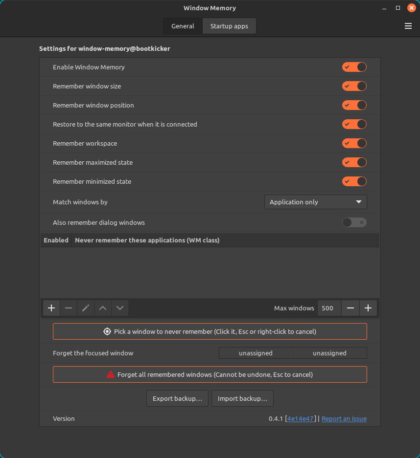
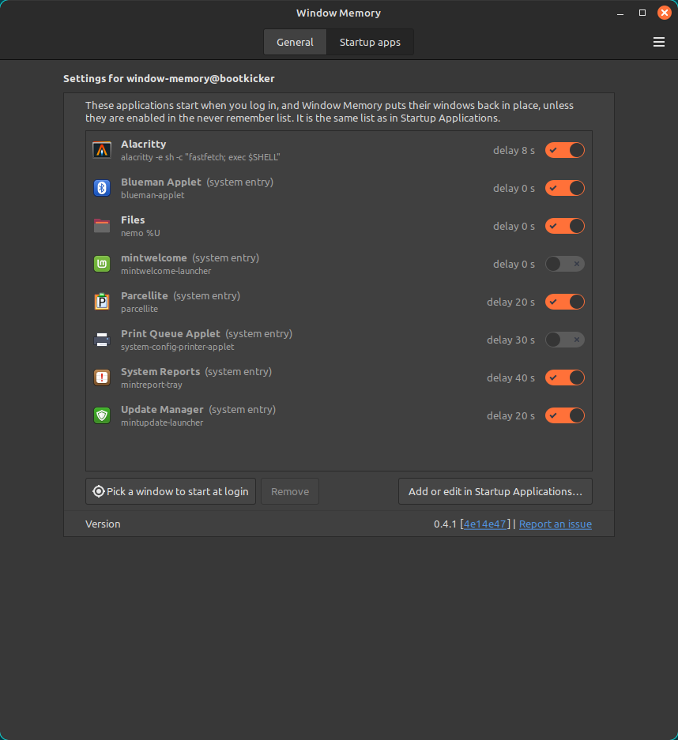

#  Window Memory

Window Memory is a Cinnamon extension for Linux Mint. It automatically remembers where each window was and puts it back when the application opens again. There are no rules to write: it saves a window's size, position, monitor, workspace, maximized state and minimized state, and restores them on the next launch.

Requirements: Cinnamon 6.0, on X11 or, experimentally, on the Cinnamon Wayland session. Tested on Linux Mint 21.3 with Cinnamon 6.0.5.

## Features

- **Automatically remembers each window** by its application: size, position, monitor, workspace, maximized and minimized state. A window is saved when you finish moving or resizing it, when it is minimized or restored, and when it closes.
- **Restores on open.** A new window is placed where the same application's window was saved. A window that was minimized reopens minimized, and Cinnamon plays its minimize sound, so you can hear that something was minimized.
- **Never remember these applications.** Applications in this list are never saved or restored. Matching uses the WM class. Untick an entry's checkbox to remember that application again without removing it.
- **Pick a window to never remember.** Click the button, then a window: its application is added to the never-remember list. While you choose, the window under the pointer is highlighted and named, and Escape or a right-click cancels.
- **Forget the focused window.** A keyboard shortcut that you set in the settings. It removes the focused window's saved place and shows a notification.
- **Forget all remembered windows.** A button. It removes every saved window and tells you how many were forgotten.
- **Back up and restore.** Export all settings, the never-remember list and the remembered windows to one file, and import it later. Import asks before it replaces anything.
- **Startup apps.** A second tab of the settings window lists your Startup Applications, with a switch for each and a Remove button, and puts their windows back in place after login. "Pick a window to start at login" adds an application by clicking its window, and one button opens Startup Applications to add or edit by hand. It works on X11 and, experimentally, on the Cinnamon Wayland session.
- **Dialogs** are remembered only when "Also remember dialog windows" is on.
- **Limit.** "Max windows" (default 500), next to the never-remember list's buttons, drops the least recently seen windows first.
- **Your language.** The extension follows the language of your Linux Mint session (24 languages).

## Install

### From the Cinnamon Spices store

1. Open System Settings → Extensions → Download.
2. Search for "Window Memory" and click Install.
3. Open the Manage tab and turn Window Memory on.
4. Click its Configure button to open the settings.

### From source

1. `git clone https://github.com/bootkicker/window-memory.git`
2. `cp -r window-memory/files/window-memory@bootkicker ~/.local/share/cinnamon/extensions/`
3. Restart Cinnamon: log out and back in, or restart it from the Cinnamon menu.
4. Turn Window Memory on in System Settings → Extensions → Manage.

## Settings - General tab

The settings window has two tabs. This is the General tab.

| Setting | Default | What it does |
|---|---|---|
| Enable Window Memory | on | Turns saving and restoring on or off. |
| Remember window size | on | Restores the saved size. |
| Remember window position | on | Restores the saved position. |
| Restore to the same monitor when it is connected | on | Puts a window back on the monitor it was on. |
| Remember workspace | on | Restores the saved workspace. |
| Remember maximized state | on | Maximizes a window that was maximized. |
| Remember minimized state | on | Minimizes a window that was minimized when it was saved. |
| Match windows by | Application only | "Application and window title" prefers the saved window with the same title. |
| Also remember dialog windows | off | Includes dialog windows. |
| Never remember these applications | empty | Applications to skip, matched by WM class. Each row has an "Enabled" checkbox: an unticked row is kept but ignored. |
| Max windows | 500 | In the button row under the list. From 10 to 5000. The least recently seen are dropped first. |
| Pick a window to never remember | button | Below the list. Click it, then a window, to add its application to the never-remember list (or to tick it again if it is there unticked). The window under the pointer is highlighted. Escape or a right-click cancels. |
| Forget the focused window | none | Keyboard shortcut. |
| Forget all remembered windows | button | Removes every saved window. Cannot be undone. |
| Export backup… and Import backup… | buttons | Save or restore everything. |
| Version row | | The last row of both tabs: the version, the commit (a link to it on GitHub) and "Report an issue". On a Wayland session a short note, "Wayland (experimental)", follows the word "Version". |

## Settings - Startup apps tab

| Setting | Default | What it does |
|---|---|---|
| Startup apps (tab) | | A second tab of the settings window. The list is the same as in Startup Applications, one row per entry (icon, name, command, delay), and stays in step with it. Each row has a switch to turn the entry on or off. System entries are dimmed and marked "(system entry)". |
| Remove | button | In the "Startup apps" tab. Deletes the selected entry; a system entry is hidden instead, as Startup Applications does. |
| Pick a window to start at login | button | In the "Startup apps" tab. Click it, then a window. An application that has an entry in the applications menu is added at once, with a message and an Undo link. Any other window (for example a terminal started with options) opens a form filled in from the window, which you check and add. Escape or a right-click cancels. An application already in the list is not added twice: it is switched on, or, if you had removed a system entry, brought back. Works on X11 and, experimentally, on the Cinnamon Wayland session. |
| Add or edit in Startup Applications… | button | In the "Startup apps" tab. Opens Cinnamon's Startup Applications, to add an entry by hand or to edit one. |
| Version row | | The last row of both tabs: the version, the commit (a link to it on GitHub) and "Report an issue". On a Wayland session a short note, "Wayland (experimental)", follows the word "Version". |

## Scripts (for developers)

These scripts are in the source repository, https://github.com/bootkicker/window-memory.

- `node --test`: unit tests.
- `scripts/check.sh`: all checks: tests, Python and shell syntax, the translation template and the git state.
- `scripts/package.sh`: builds `dist/window-memory@bootkicker/` in the Spices layout. It needs `screenshot.png`.
- `scripts/release.sh <version>`: prepares a release locally. Add `--submit` to publish it; it checks that the repository is public.
- `scripts/dev-reinstall.sh`: copies the source into the extensions folder. Then disable and enable the extension, or restart Cinnamon.
- `scripts/dev-status.sh`: shows whether the installed copy matches the source, and what Cinnamon is running.
- `scripts/dev-watch-state.sh`: prints saved entries as they change.
- `scripts/api-watch.js <cinnamon-js-dir> <muffin-headers-dir>`: reports calls the extension uses that are missing in a Cinnamon release.

## Limitations

- X11 is the default session of Linux Mint and the best tested. Cinnamon's Wayland session is itself experimental; there the extension was tested with Cinnamon 6.0.5 (native Wayland and XWayland windows).
- A window is identified by its class and instance (its app id on Wayland). For some applications these differ between the two sessions. A small built-in list matches the two for gnome-terminal, LibreOffice (Writer, Calc, Impress, Draw, Math and Base), Meld, Drawing, Thunderbird, Firefox, BleachBit, Ghostty and the KDE applications Kate, KWrite, Dolphin, Konsole, Okular, Ark, Gwenview, KCalc, Konqueror and Discover (gnome-terminal, LibreOffice Writer, Calc and Impress, Meld and Drawing were checked in both sessions, and Thunderbird restores on Wayland; the others are expected to match). Most applications, such as Nautilus, GNOME Calculator, Archive Manager, Xreader, Xviewer, Pix and Mousepad, have the same key in both sessions and need no entry; for another application whose class differs, the place saved by the same application (its desktop file) as the other kind of window, X11 or native Wayland, is used when nothing else matches; an application with no desktop file is not matched.
- On Wayland a window restored maximized first appears at its saved size for a moment, then becomes maximized.
- A window can flash once before it is moved to its saved place.
- Applications that show their own window at startup (Xed, for example) can reopen normally.
- Another extension that moves windows can conflict with this one.
- The translations were prepared without a native-speaker review. If something reads wrong in your language, please open an issue.

## If Window Memory stops itself

When it cannot work safely, Window Memory stops itself and shows one notification that says why. This happens when a function it needs is missing from your version of Cinnamon, when it cannot start, when it meets too many errors, or when Cinnamon restarts repeatedly. A stop is remembered across restarts and logins, so it does not start again by itself, and it never deletes or resets your saved windows. To resume, turn "Enable Window Memory" off and on in its settings, or delete `~/.config/window-memory/safety.json`; the extension does not watch that file, so after deleting it log out and in again, or disable and enable the extension. If it happens again, please report an issue. On Wayland (experimental) a Cinnamon crash ends the session and the next login is a new session, so the check for repeated restarts does not apply there.

## Your data

Saved windows are kept in `~/.config/window-memory/state.json`. They include window titles. The extension makes no network connections. To delete everything, press "Forget all remembered windows", or remove the file while the extension is disabled.

## Report a problem

Use "Report an issue" in the Version row of the settings window, or open an issue at https://github.com/bootkicker/window-memory/issues/new?template=bug_report.md.

## License

GPL-3.0-or-later. See `LICENSE`.
